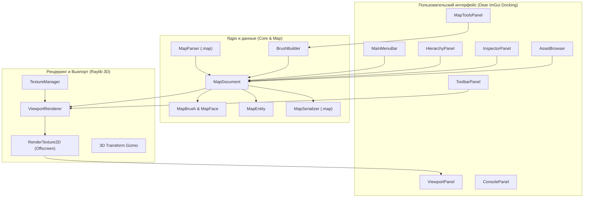

# Архитектура движка KnopMops Engine

## 1. Обзор системы

KnopMops Engine — это автономный редактор 3D-карт и уровней для игр в жанре Retro Survival Horror и ретро-FPS.

---

## 2. Потоки данных

1. **Загрузка карты**:
   `MapParser::LoadFromFile(path, doc)` считывает текстовый `.map`, токенизирует браши и сущности, строит вершины полигонов через полупространственное отсечение (`ClipPolygon`) и передаёт готовый `MapDocument` во вьюпорт и иерархию.

2. **Рендеринг кадра**:
   В методе `ViewportRenderer::Render(doc)` сцена отрисовывается в текстуру `RenderTexture2D`:
   * Отрисовка координатной сетки пола ($XZ$).
   * Отрисовка полигонов брашей с текстурами и контурами.
   * Отрисовка габаритных рамок (`BoundingBox`) и хитбоксов сущностей.
   * Отрисовка 3D-манипулятора перемещения/вращения (Gizmo).
   * Готовая текстура передаётся в ImGui через `rlImGuiImageRenderTextureFit(...)`.

3. **Интеракция и манипуляторы**:
   Клик мыши в окне вьюпорта преобразуется в луч `Ray = GetScreenToWorldRay(mousePos, camera)`.
   * Пересечение с ручками манипулятора (`Gizmo`) активирует режим перетаскивания вдоль осей $X$, $Y$ или $Z$ с шагом сетки (`gridSnap`).
   * Клик по пустому месту производит поиск ближайшего браша или сущности через `RayIntersectsBox`.

4. **Экспорт в игру**:
   По кнопке `Save Map` вызывается `MapSerializer::SaveToFile(path, doc)`. Сгенерированный файл напрямую открывается в игре «Последний заказ» (Last Order) через класс `QuakeMap`.

---

## 3. Модули проекта

* `src/core/`:
  * `Math3D.h`: математика векторов, плоскостей, рэйкастов и преобразования координат Quake $\leftrightarrow$ World.
  * `Log.h`: потокобезопасный кольцевой буфер сообщений.
* `src/map/`:
  * `MapData.h`, `MapData.cpp`: структуры данных карты, многоугольников и сущностей.
  * `BrushBuilder.h`, `BrushBuilder.cpp`: процедурное создание комнат, кубов, полых объёмов и цилиндров.
  * `MapParser.h`, `MapParser.cpp`: парсер формата Quake / Valve 220 `.map`.
  * `MapSerializer.h`, `MapSerializer.cpp`: запись карт в стандартный формат `.map`.
* `src/render/`:
  * `TextureManager.h`, `TextureManager.cpp`: загрузка, кэширование и миниатюры текстур.
  * `ViewportRenderer.h`, `ViewportRenderer.cpp`: 3D-вьюпорт, свободная камера, сетка, хитбоксы и гизмо.
* `src/ui/`:
  * `UnityTheme.h`: палитра и скругления в стиле Unity Dark.
  * `EditorUI.h`, `EditorUI.cpp`: компоновка докинга, панели меню, иерархии, инспектора и инструментов.

